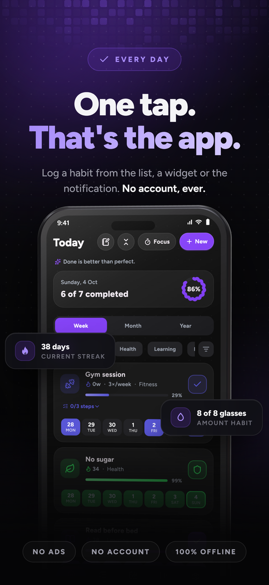
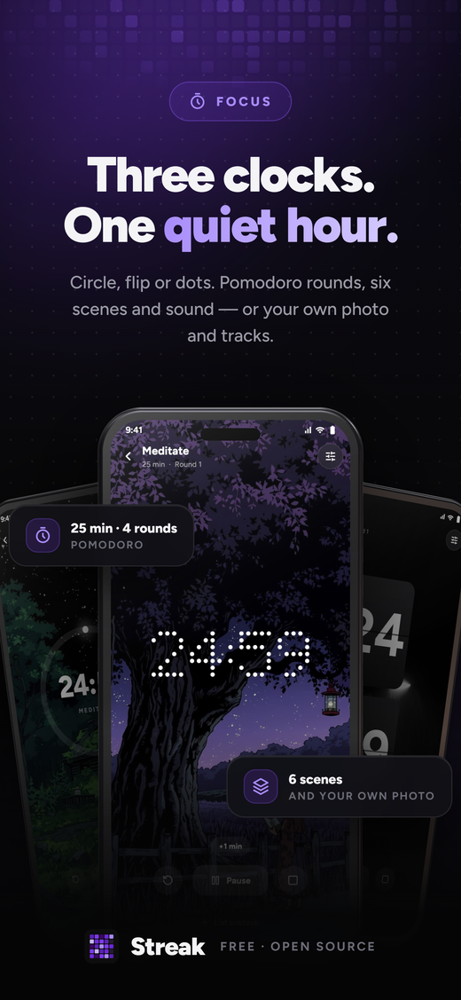
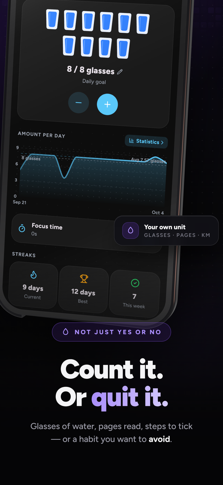
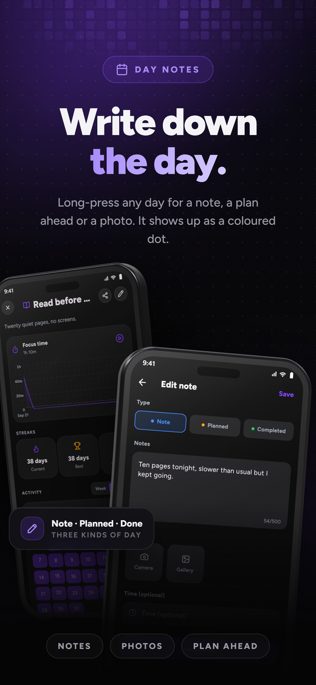
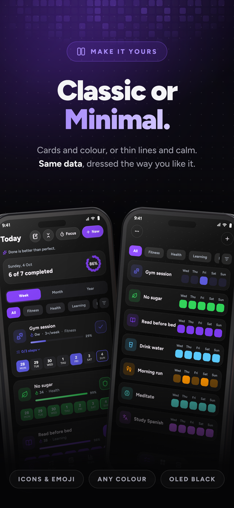
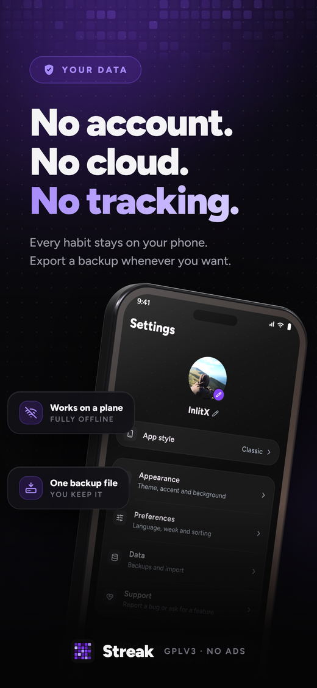

<div align="center">


### 🔥 A beautiful, private, and minimal habit tracker for Android, Windows & Linux

Log a habit in a single tap, keep your momentum, launch habit websites, and track your daily screen activity without subscriptions or ads.

<br/>

[](https://github.com/aditya452007/habito/stargazers)
[](https://github.com/aditya452007/habito/network/members)
[](https://github.com/aditya452007/habito/releases/latest)
[](LICENSE)
[](https://github.com/aditya452007/habito#privacy)

<p>
  <a href="https://twitter.com/intent/tweet?text=Check%20out%20Habito%20%E2%80%94%20a%20beautiful%2C%20private%2C%20and%20open-source%20habit%20tracker%20with%20zero%20ads%20and%20PC%20tracking!&url=https%3A%2F%2Fgithub.com%2Faditya452007%2Fhabito"></a>
  &nbsp;
  <a href="https://www.reddit.com/submit?title=Habito%20-%20A%20free%2C%20private%20and%20minimal%20open-source%20habit%20tracker%20for%20Android%20and%20PC&url=https%3A%2F%2Fgithub.com%2Faditya452007%2Fhabito"></a>
</p>

<br/>

<a href="https://github.com/aditya452007/habito/releases/latest"></a>
&nbsp;
<a href="https://apps.obtainium.imranr.dev/redirect?r=obtainium://app/%7B%22id%22%3A%22com.streak.app%22%2C%22url%22%3A%22https%3A%2F%2Fgithub.com%2Faditya452007%2Fhabito%22%2C%22author%22%3A%22aditya452007%22%2C%22name%22%3A%22Habito%22%2C%22preferredApkIndex%22%3A0%2C%22additionalSettings%22%3A%22%7B%5C%22includePrereleases%5C%22%3Afalse%2C%5C%22fallbackToOlderReleases%5C%22%3Atrue%2C%5C%22filterReleaseTitlesByRegEx%5C%22%3A%5C%22%5C%22%2C%5C%22filterReleaseNotesByRegEx%5C%22%3A%5C%22%5C%22%2C%5C%22verifyLatestTag%5C%22%3Afalse%2C%5C%22dontSortReleasesList%5C%22%3Afalse%2C%5C%22useLatestAssetDateAsReleaseDate%5C%22%3Afalse%2C%5C%22trackOnly%5C%22%3Afalse%2C%5C%22versionExtractionRegEx%5C%22%3A%5C%22%5C%22%2C%5C%22matchGroupToUse%5C%22%3A%5C%22%5C%22%2C%5C%22versionDetection%5C%22%3Atrue%2C%5C%22releaseDateAsVersion%5C%22%3Afalse%2C%5C%22useVersionCodeAsOSVersion%5C%22%3Afalse%2C%5C%22apkFilterRegEx%5C%22%3A%5C%22%5C%22%2C%5C%22invertAPKFilter%5C%22%3Afalse%2C%5C%22autoApkFilterByArch%5C%22%3Atrue%2C%5C%22appName%5C%22%3A%5C%22%5C%22%2C%5C%22shizukuPretendToBeGooglePlay%5C%22%3Afalse%2C%5C%22allowInsecure%5C%22%3Afalse%2C%5C%22exemptFromBackgroundUpdates%5C%22%3Afalse%2C%5C%22skipUpdateNotifications%5C%22%3Afalse%2C%5C%22about%5C%22%3A%5C%22Habito%20is%20an%20open%20source%20habit%20tracker.%20Build%20habits%20with%20one%20tap%2C%20watch%20your%20progress%20grow%2C%20and%20keep%20everything%20on%20your%20device.%20No%20accounts%2C%20no%20ads%2C%20no%20tracking.%5C%22%7D%22%2C%22overrideSource%22%3Anull%7D"></a>

<br/>

> 🌟 **If you find Habito helpful, please give it a star on GitHub — it helps the project grow and reach more people!**

<sub>
  <a href="#why-habito">Why Habito?</a> ·
  <a href="#screenshots">Screenshots</a> ·
  <a href="#features">Features</a> ·
  <a href="#download">Download</a> ·
  <a href="#about-the-developer">Developer</a> ·
  <a href="#license">License</a>
</sub>

</div>

---

## ⚡ Why Habito?

Most habit trackers lock basic capabilities behind $40–$80/year subscriptions, bombard you with ads, or send your personal habits to remote analytics servers.

**Habito was built to be different:**

| Feature | 🌿 Habito (Open Source) | 🏢 Commercial Trackers (Habitica, Fabulous) | 📝 Generic Notes / Notion |
| :--- | :---: | :---: | :---: |
| **Pricing** | **100% Free Forever** | $4.99–$9.99 / month | Subscription / Freemium |
| **Privacy & Offline** | **100% Local (0 Network Requests)** | Cloud database & Telemetry | Account required |
| **Ads & Tracking** | **Zero Ads, Zero Tracking** | Banner ads & upsell screens | Product upsells |
| **Website Habit Launcher** | **✅ Direct 1-Click Launch Icon** | ❌ No | ❌ Manual hyperlinks |
| **Windows Active Usage Tracker** | **✅ Native (<25MB RAM, 0% CPU)** | ❌ No | ❌ No |
| **Gamified Voxel Island** | **✅ Built-in Visual Progression** | Paid RPG or None | ❌ No |
| **Focus Timer & White Noise** | **✅ Pomodoro + Ambient Soundscapes** | Paywalled | ❌ No |
| **Cross-Platform Support** | **Android, Windows & Linux** | Mobile only or Web wrapper | Heavy browser app |

---

## 📸 Screenshots

<div align="center">










<sub><b>Today</b> · <b>Focus</b> · <b>Statistics</b> · <b>Insights</b> · <b>Amounts</b> · <b>Notes</b> · <b>Themes</b> · <b>Local Privacy</b></sub>

</div>

---

## ✨ Features

<table>
<tr>
<td width="50%" valign="top">

### 🎯 Comprehensive Habit Tracking
- **One-tap logging**: Complete habits instantly from home screen, widgets, or desktop sidebar.
- **Three habit models**:
  - **Normal**: Positive habits you want to cultivate daily or on specific days.
  - **Avoid**: Habits you want to break, with full relapse tracking and clean streaks.
  - **Amount**: Track numerical targets (e.g., 2,500 ml water, 30 pages read, 10,000 steps).
- **Flexible scheduling**: Daily, $X$ days per week/month, custom weekdays, or repeating intervals.
- **Checklists & sub-steps**: Break large routines into bite-sized actionable items.

</td>
<td width="50%" valign="top">

### 🌐 Website Habit Quick-Launcher
- Attach direct website URLs to habits (e.g. Duolingo, LeetCode, Coursera, GitHub, documentation).
- Dedicated launcher icon opens the website directly in your default browser.
- Complete the online learning task and mark your habit done with zero friction.

### 💻 Windows Native Activity Tracker
- Ultra-optimized 64-bit background service consuming **<25 MB RAM** and **0.0% CPU**.
- Categorizes active application time into **Development**, **Browsing**, **Productivity**, and **Entertainment**.
- Idle detection and automatic working set trimming on window minimize.

</td>
</tr>
<tr>
<td width="50%" valign="top">

### 🏝️ Gamified Island & Focus Timer
- **Voxel Island**: Grow a peaceful 3D voxel island as your streaks thrive.
- **Pomodoro Timer**: Customizable work and rest intervals with smooth animations.
- **Calm Soundscapes**: Built-in rain, fire, forest, brown noise, and lo-fi audio tracks that work completely offline.

</td>
<td width="50%" valign="top">

### 🎨 Antigravity Responsive Split Layout
- Resizable 3-pane desktop view with intuitive drag handles and snap thresholds.
- Antigravity section toggle icons for one-click collapsing/expanding.
- Eye-comfort palettes: Antigravity Slate, High-Contrast Dark, and Clean Light themes.

</td>
</tr>
</table>

---

## 📥 Download

### 📱 Android
Download the APK for your device architecture from the [**Latest Release**](https://github.com/aditya452007/habito/releases/latest):
- **[`Habito-arm64-v8a.apk`](https://github.com/aditya452007/habito/releases/latest)**: Recommended for all modern Android phones.
- **[`Habito-armeabi-v7a.apk`](https://github.com/aditya452007/habito/releases/latest)**: For older 32-bit Android devices.
- **[`Habito-x86_64.apk`](https://github.com/aditya452007/habito/releases/latest)**: For Android emulators and Chromebooks.

### 🪟 Windows (64-bit)
- **Installer**: Download **`Habito-windows-x64-setup.exe`** from [Releases](https://github.com/aditya452007/habito/releases/latest) and double-click to install.
- **Portable ZIP**: Download **`Habito-windows-x64.zip`**, extract anywhere, and run `Streak.exe`.

### 🐧 Linux (x86_64)
- **AppImage**: Download **`Streak-x86_64.AppImage`**, make it executable (`chmod +x`), and run.
- **Tarball**: Download **`Streak-linux-x64.tar.gz`** and extract.

---

## 🛠️ Building from Source

```bash
# 1. Clone the repository
git clone https://github.com/aditya452007/habito.git
cd habito

# 2. Get Flutter dependencies and generate localizations
flutter pub get

# 3. Verify static analysis and tests
flutter analyze --no-fatal-infos
flutter test

# 4. Run Habito locally
flutter run
```

---

## 👤 About the Developer

<div align="center">


### **Aaditya Thakur**
**Lead Developer & Maintainer**

GitHub: [@aditya452007](https://github.com/aditya452007) &nbsp;•&nbsp; Location: **Bhopal, Madhya Pradesh, India** &nbsp;•&nbsp; Email: [**adityathakur452007@gmail.com**](mailto:adityathakur452007@gmail.com)

*Passionate about open-source tools, system performance, and crafting clean user experiences.*

<p>
  <a href="https://github.com/aditya452007"></a>
  &nbsp;
  <a href="https://github.com/aditya452007/habito"></a>
</p>

</div>

---

## 🤝 Contributing

Contributions, feedback, and translations are warmly welcome!
- Check out the [Contribution Guidelines](CONTRIBUTING.md).
- Help translate Habito into your language via [Translation Guide](TRANSLATING.md).
- Report bugs or propose features on [GitHub Issues](https://github.com/aditya452007/habito/issues).

---

## 📄 License

Habito is open source software published by **Aaditya Thakur** under the [**GNU GPLv3**](LICENSE) license, with the reasonable author attribution terms in [ADDITIONAL_TERMS.md](ADDITIONAL_TERMS.md).
